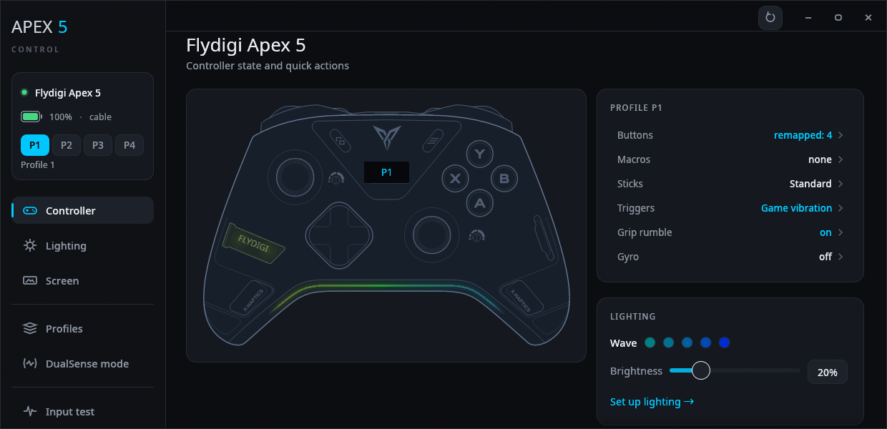
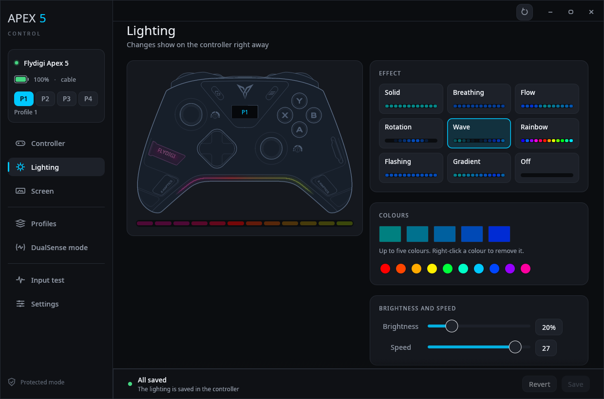
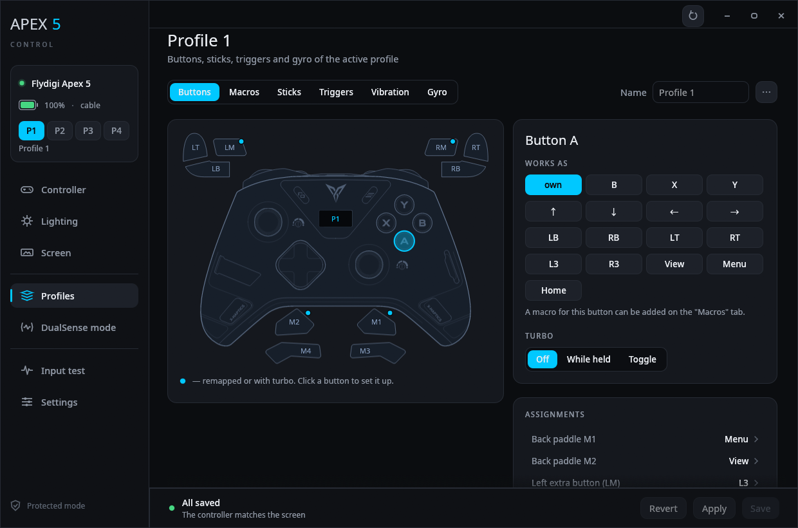
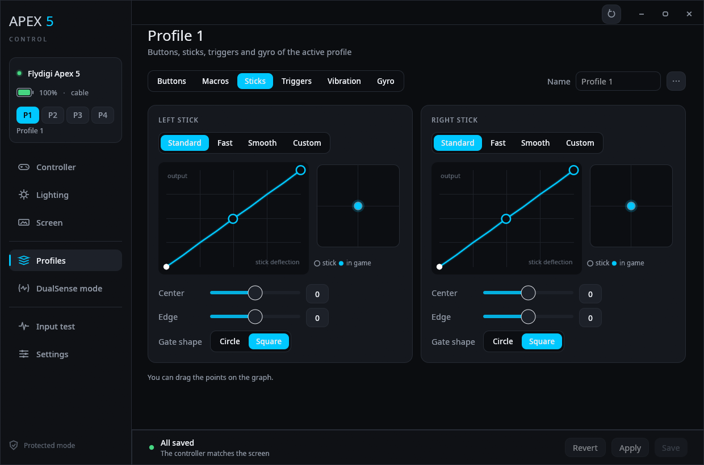
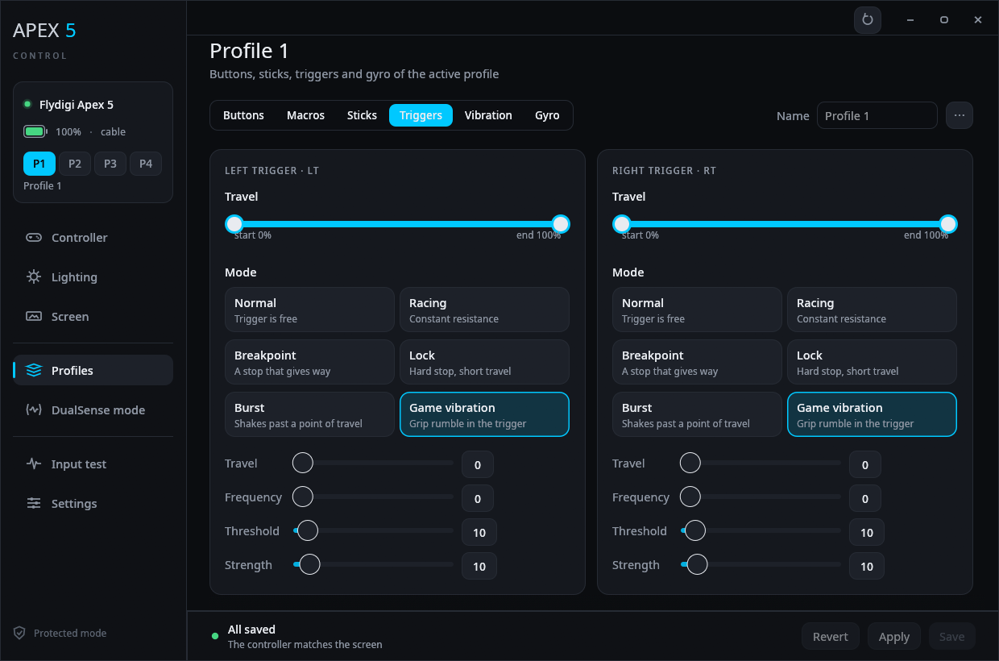
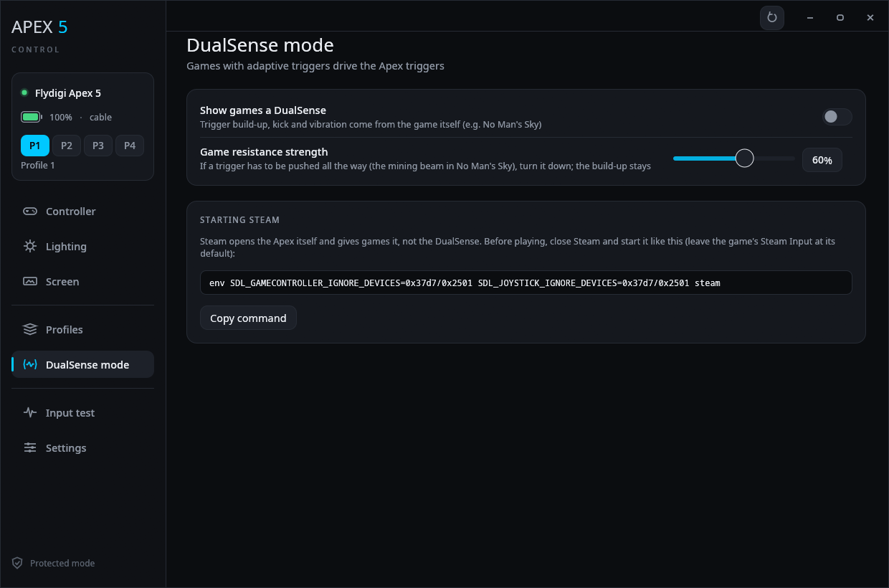
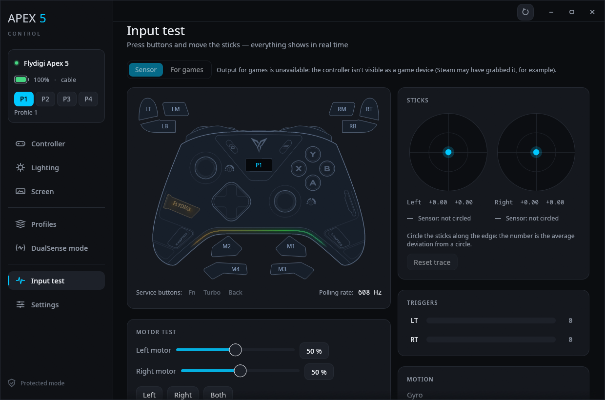
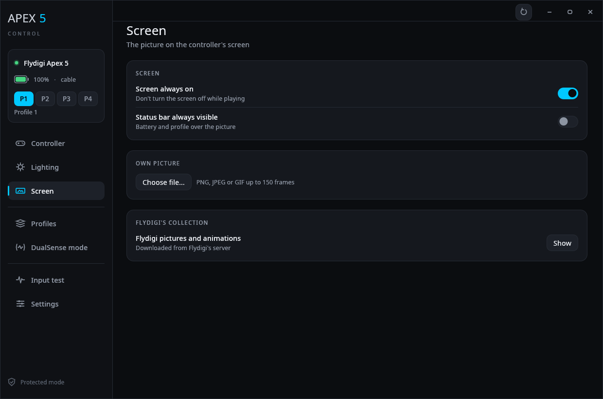
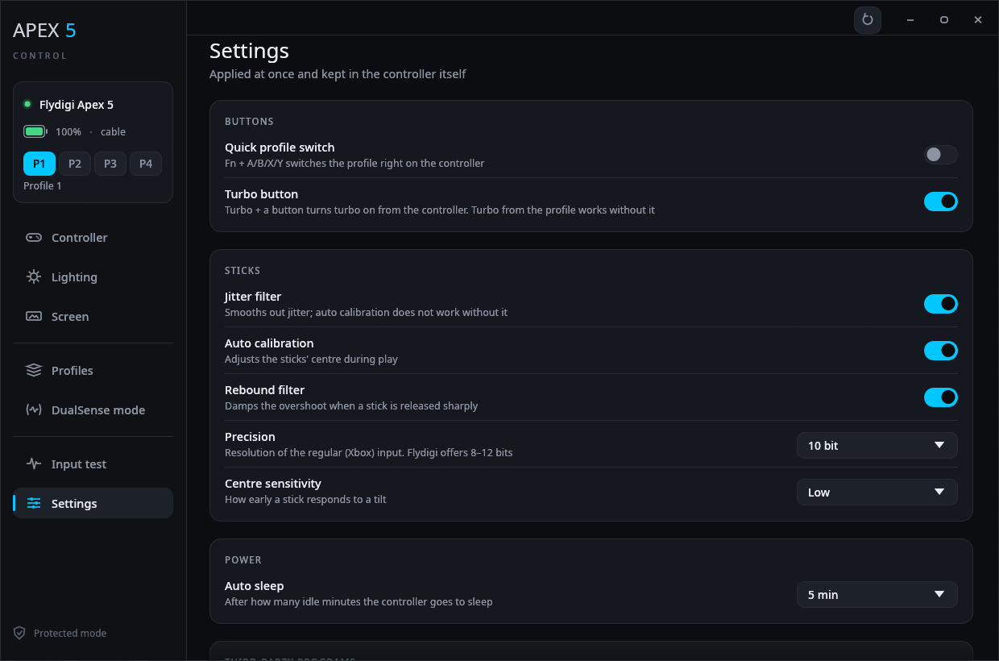

<div align="center">

# Apex 5 Control

**A native Linux app for the Flydigi Apex 5 controller**

Lighting, profiles, macros, sticks, adaptive triggers, gyro and the controller's screen —
without Windows and without Flydigi Space Station.

[](https://github.com/JohnHenrySpike/apex-portal/actions/workflows/ci.yml)
[](https://github.com/JohnHenrySpike/apex-portal/releases/latest)


**English** · [Русский](README.ru.md)



</div>

## Contents

- [Features](#features)
- [Screenshots](#screenshots)
- [Install](#install)
- [DualSense mode](#dualsense-mode)
- [Command-line tool](#command-line-tool)
- [Safety](#safety)
- [Flydigi's server](#flydigis-server)
- [Languages](#languages)
- [How it works](#how-it-works)
- [Credits](#credits)

## Features

| Section | What you can do |
|---|---|
| **Controller** | model, connection, battery, firmware versions, UID, controller name |
| **Lighting** | per profile: 9 effects, up to 5 colours, brightness, speed, flash on rumble, live preview, save to flash |
| **Profiles** (4 slots) | switching, names, button remapping, turbo, M1–M4 back paddles and LM/RM, copy to another slot, save to and load from a file (with lighting) |
| **Macros** | up to 5 macros of 128 steps, run by the controller itself |
| **Sticks** | presets, dead zone and outer zone, anti-dead zone and output ceiling, a two-point curve, circle or square gate, curve graph |
| **Triggers** | travel (hair trigger), adaptive modes: racing, breakpoint, lock, burst (the trigger shakes past a point of travel), game vibration in the triggers with Flydigi's presets for 35 games |
| **Grip rumble** | on/off, strength, minimum and maximum of each motor |
| **Gyro** | gyro as a stick, activation button, dead zone, sensitivity |
| **Screen** | your own picture or animation on the controller's screen, or one from Flydigi's collection |
| **Settings** | quick profile switch, Turbo button, stick filters and auto calibration, precision, centre sensitivity, auto sleep, firmware update check, third-party grab (Steam), reset all profiles (and lighting) to factory |
| **DualSense mode** | games see the controller as a DualSense: games with adaptive triggers (e.g. No Man's Sky) drive the Apex triggers themselves — build-up, kick, vibration; grip rumble and the gyro go through it too |
| **Input test** | sticks, triggers, every button (M1–M4/LM/RM included), gyro, accelerometer, polling rate, stick circularity, rumble motor check; the "For games" view shows what games get after remapping, turbo and macros |

## Screenshots

<table>
  <tr>
    <td></td>
    <td></td>
  </tr>
  <tr>
    <td align="center"><b>Lighting</b> — effects, colours, live preview</td>
    <td align="center"><b>Buttons</b> — remapping, turbo, back paddles</td>
  </tr>
  <tr>
    <td></td>
    <td></td>
  </tr>
  <tr>
    <td align="center"><b>Sticks</b> — response curve, zones, gate shape</td>
    <td align="center"><b>Triggers</b> — travel and adaptive modes</td>
  </tr>
  <tr>
    <td></td>
    <td></td>
  </tr>
  <tr>
    <td align="center"><b>DualSense mode</b> — adaptive triggers from games</td>
    <td align="center"><b>Input test</b> — everything in real time</td>
  </tr>
  <tr>
    <td></td>
    <td></td>
  </tr>
  <tr>
    <td align="center"><b>Screen</b> — your own picture or animation</td>
    <td align="center"><b>Settings</b> — kept in the controller itself</td>
  </tr>
</table>

## Install

### From a release

Download `apex5-vX.Y.Z-linux-x86_64.tar.gz` from the [Releases](https://github.com/JohnHenrySpike/apex-portal/releases) page, then:

```bash
tar xzf apex5-*-linux-x86_64.tar.gz
cd apex5-*-linux-x86_64
install -Dm755 apex5 apex5ctl -t ~/.local/bin
install -Dm644 packaging/apex5-control.desktop ~/.local/share/applications/apex5-control.desktop
```

Builds of the `dev` branch are kept as artifacts of its runs on the [Actions](https://github.com/JohnHenrySpike/apex-portal/actions/workflows/ci.yml) page.

### From source

You need Rust (stable, edition 2024); no system libraries are required.

```bash
cargo build --release
install -Dm755 target/release/apex5 target/release/apex5ctl -t ~/.local/bin
install -Dm644 packaging/apex5-control.desktop ~/.local/share/applications/apex5-control.desktop
```

`tools/dist.sh NAME` packs the same archive as a release.

### udev rule

If the app says it has no access, install the udev rule. The screen picture upload and DualSense mode need it too.
The app can install it itself (the **Install rule…** button; the system asks for your password), or by hand:

```bash
sudo install -Dm644 packaging/72-flydigi-apex5.rules /etc/udev/rules.d/72-flydigi-apex5.rules
```

```bash
sudo udevadm control --reload && sudo udevadm trigger
```

> [!TIP]
> Changes go to the controller's working memory first (**Apply**). To keep them through sleep and power-off,
> press **Save**: it writes them to the controller's flash.

## DualSense mode

The app creates a virtual DualSense (through `/dev/uhid`) and feeds it the Apex input — buttons and sticks the way games
see them, after the profile's remapping, plus the gyro and accelerometer. The trigger effects a game sends to the DualSense
become Apex modes:

| DualSense effect | Apex mode |
|---|---|
| resistance | **Racing**, its strength follows the effect |
| wall | **Breakpoint** |
| vibration | **Burst**, at the game's frequency |

While the mode is on, the profile's trigger effects don't apply. **Game resistance strength** weakens the resistance
(not the vibration) if a trigger has to be pushed all the way; it is kept in `~/.config/apex5-control/dualsense.json`.

Closing the window while the mode is on leaves the app in the system tray, and the DualSense keeps working. Clicking the
icon or starting the app again brings the window back; **Quit** in the icon's menu turns the mode off and closes the app.
A second copy doesn't start; it shows the first one's window instead.

> [!IMPORTANT]
> Steam opens the Apex with its own driver and gives games that instead of the DualSense. Close Steam before playing
> and start it like this:
>
> ```bash
> env SDL_GAMECONTROLLER_IGNORE_DEVICES=0x37d7/0x2501 SDL_JOYSTICK_IGNORE_DEVICES=0x37d7/0x2501 steam
> ```
>
> Leave the game's Steam Input at its default: No Man's Sky doesn't see the controller without it, and the DualSense
> gets its trigger effects through it.

The mode needs the `uhid` module and access to `/dev/uhid`. The same udev rule grants the access; load the module at boot with:

```bash
echo uhid | sudo tee /etc/modules-load.d/uhid.conf
```

## Command-line tool

`apex5ctl` works next to the app:

| Command | What it does |
|---|---|
| `info` | controller information |
| `input [seconds]` | raw input stream |
| `keys [seconds]` | buttons on the xpad output |
| `led show\|slots\|color\|brightness\|save` | lighting |
| `profile switch N\|backup` | switch or back up profiles |
| `screen preview\|upload` | a picture on the screen |
| `ds5` | DualSense mode without a window, until Ctrl-C |
| `cloud firmware\|games\|pictures` | what Flydigi's server has |

Saved profiles live in `~/.config/apex5-control/profiles/`.

## Safety

Every outgoing packet is checked against an allow list in `src/safety.rs`. **Never sent:**

- rumble (0x12) — only by the test button: the two grip motors, under a second, then a forced stop;
- firmware mode (31; the one exception is a single exact packet for the screen, see below), factory reset (253), reset of all profiles (175);
- Xbox/Switch mode change (27), reboot (29), polling rate (20);
- factory and test commands (240–253), HID picture upload (208–211), third-party grab (28);
- device type overwrite (254): it changes the model by which both Space Station and this app recognise the controller.

<details>
<summary>Triggers, the screen upload and the device type</summary>

Trigger effects are sent in the same forms Space Station uses: modes 0–4 with command 81, "Game vibration" with
binding 82 (the grip rumble goes into the trigger). The binding lives while the controller is connected, even across
profile switches, so the app removes it (82 with type 0) as soon as a loaded profile's trigger is not in "Game vibration".
A profile with an unknown trigger mode is not written.

Your own picture is uploaded the way Flydigi does it: command 31 puts the screen chip into upload mode, and the frames go
through its serial port `ffaa:5555`. Command 31 is sent only to the screen chip and only over a cable (through the dongle
the controller hangs until it is switched off). Only the picture area whose address the screen itself reports is written;
nothing is retried. An upload takes about 25 seconds per frame, and the controller restarts at the end. If it was
interrupted, it can be repeated; if that fails, switch the controller off and on with the switch on its back.

The app only reads the device type. If the controller is no longer recognised as an Apex 5, Space Station may have
rewritten its type: on every connection it sends the controller's data (UID, MAC, type, firmware versions) to
`edge.flydigi.com` and, if the server says the type is wrong, writes the type from the reply into the controller and
restarts it.

</details>

## Flydigi's server

The app talks to Flydigi's server (`api.flydigi.com`) only when you press a button, and with the same requests
Flydigi Space Station makes. No account and no tokens.

- **Firmware check** (Settings → About the device → **Check**): the model and firmware versions go to the server; newer
  versions and Flydigi's change notes (usually in Chinese) come back. The app doesn't download or install firmware:
  update it in Flydigi Space Station on Windows.
- **Flydigi's collection** (Screen): official Apex 5 pictures and animations. They are downloaded to
  `~/.cache/apex5-control/flydigi/screen/` and uploaded to the screen like your own file.
- **Trigger presets for games** (Profiles → Triggers): for every game on Flydigi's list it is known how to pass grip
  rumble into the triggers. A preset puts both triggers into "Game vibration" with those settings; Space Station turns
  them on by itself while the game runs, here they are kept in the profile.

The device type check (`edge.flydigi.com`), analytics and account sign-in are not repeated by the app.

## Languages

The interface is in English by default; Russian is picked in **Settings → App → Language** (or on the
"Controller not found" screen). The choice is kept in `~/.config/apex5-control/language`; `APEX5_LANG=ru` sets the
language for one run. The command-line tool is always in English.

Translations live in `locales/*.json`; how to add your own language is in [locales/README.md](locales/README.md).

## How it works

| Path | What's there |
|---|---|
| `src/hid.rs` | access to the vendor hidraw interface (interface 2, usage page 0xFFA0), packet format and block transfers |
| `src/safety.rs` | the command allow list |
| `src/device.rs` | info, settings, name, input stream, trigger resistance |
| `src/lighting.rs` | the lighting block (380 bytes: 10 frames × 12 LEDs) |
| `src/profile.rs` | a profile (840 bytes): buttons, sticks, triggers, gyro, macros |
| `src/worker.rs` | the background thread that owns the device |
| `src/bridge.rs`, `src/ds5.rs`, `src/uhid.rs` | DualSense mode: the virtual controller, its reports, trigger effect translation |
| `src/main.rs`, `src/ui/` | the interface |
| `src/lang.rs`, `locales/`, `tools/i18n.py` | interface languages: English in the code, translations in JSON |
| `assets/apex5.svg` | the controller drawing, built by the scripts in `tools/svg` (see `tools/svg/README.md`) |
| `docs/spec-*.md` | protocol specification |

## Credits

The protocol comes from the research of the [openflydigi](https://github.com/mkaliaha/openflydigi) project (MIT).
The DualSense descriptor, feature reports and input report layout come from there too (`LICENSES/openflydigi-MIT.txt`).
