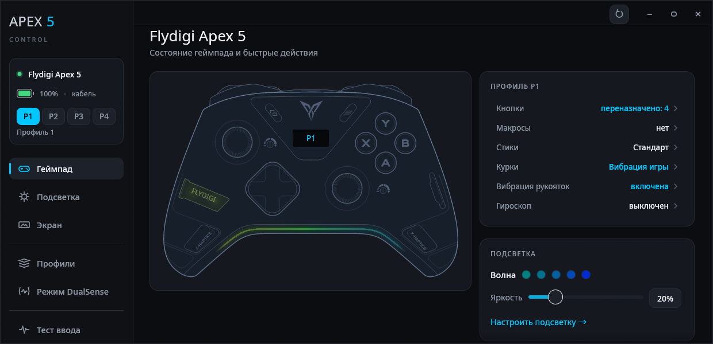
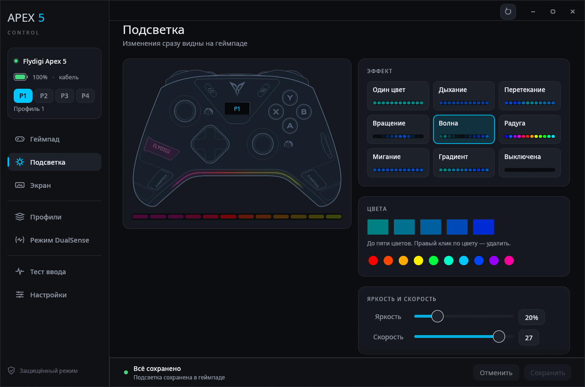
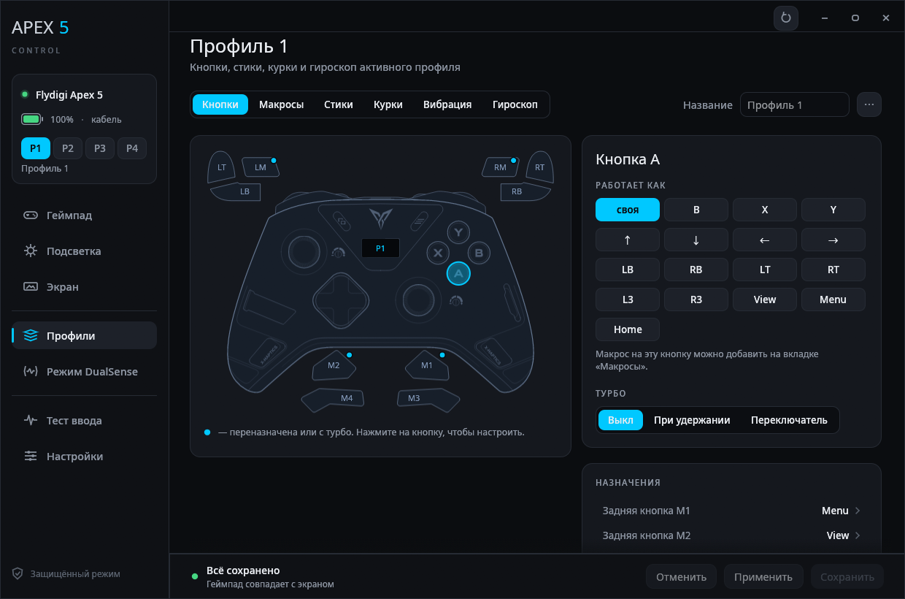
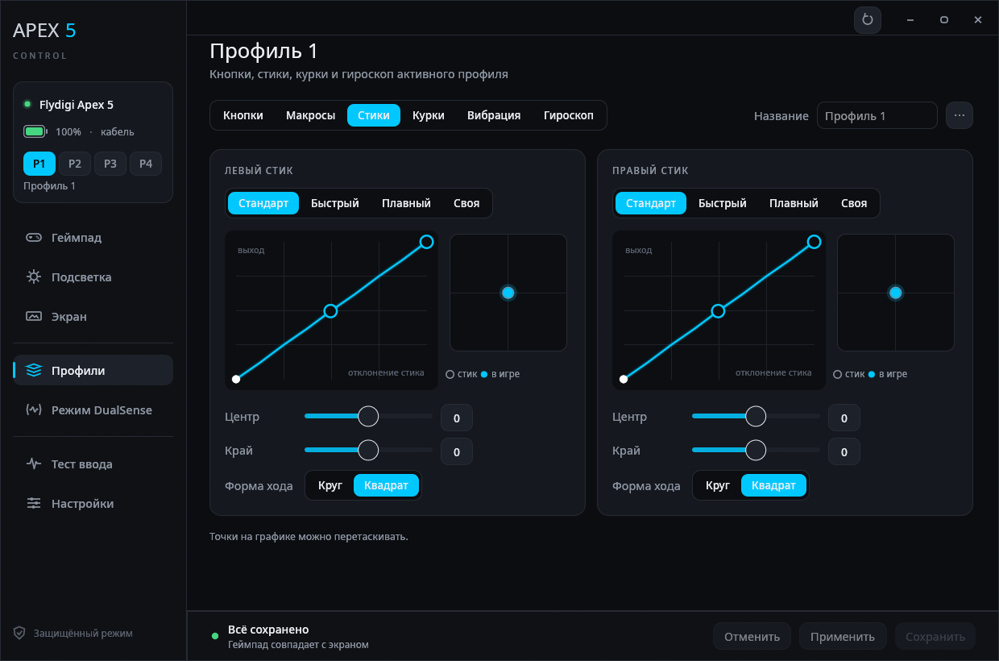
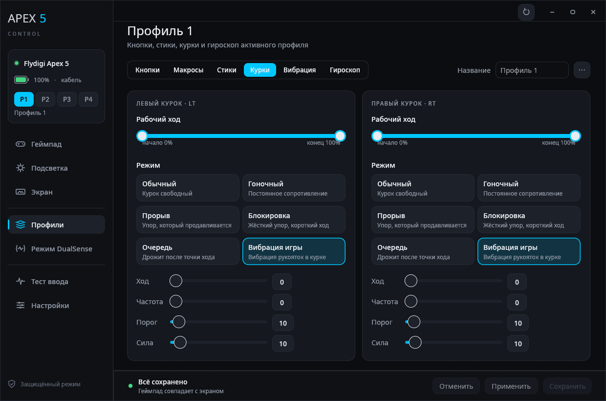
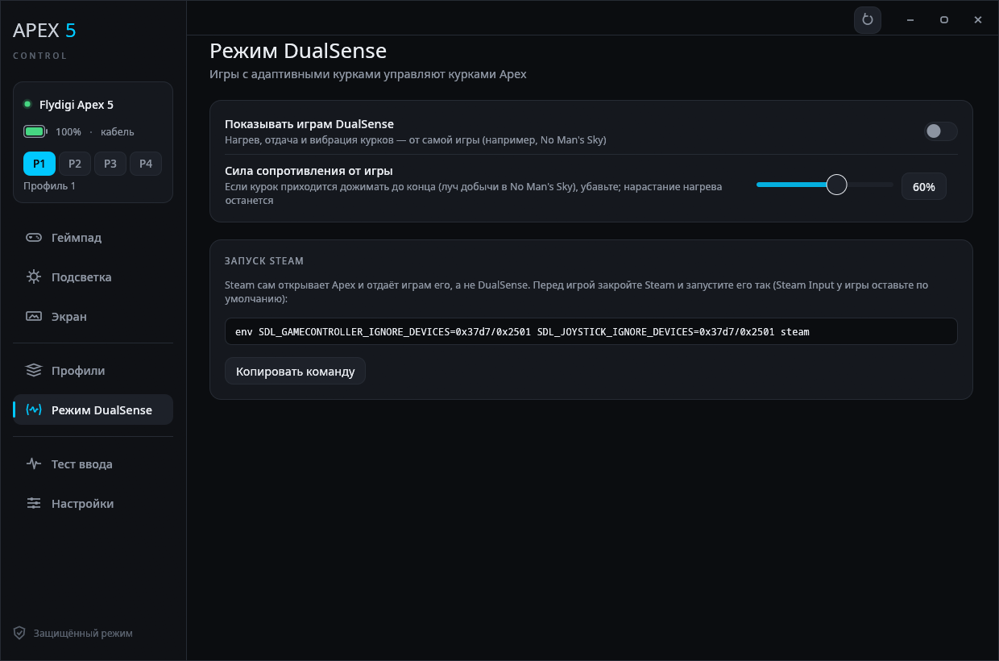
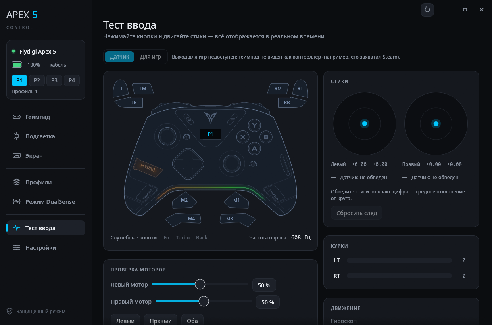
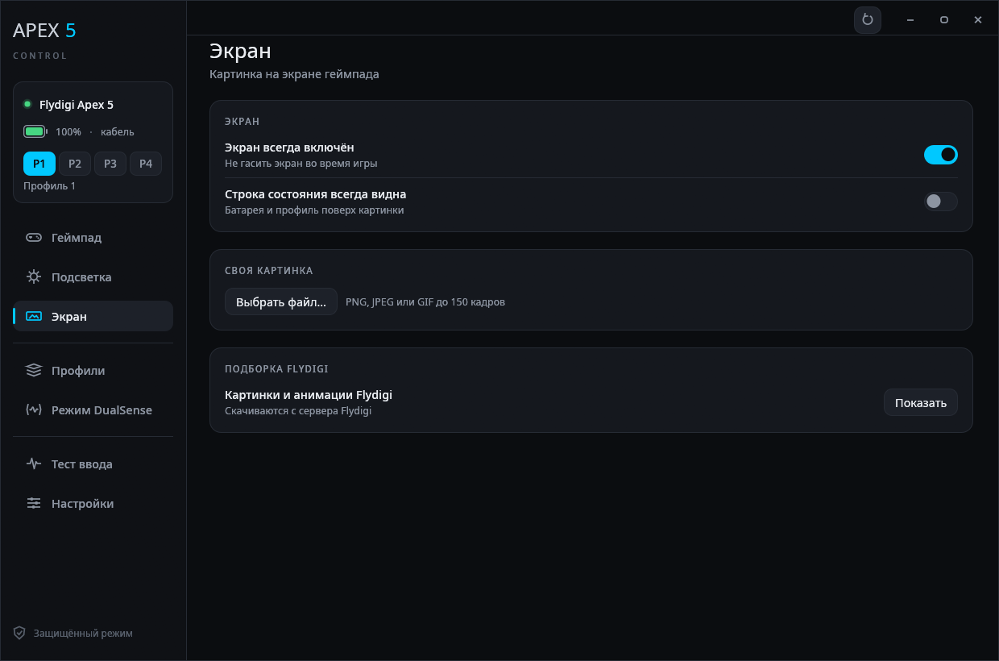
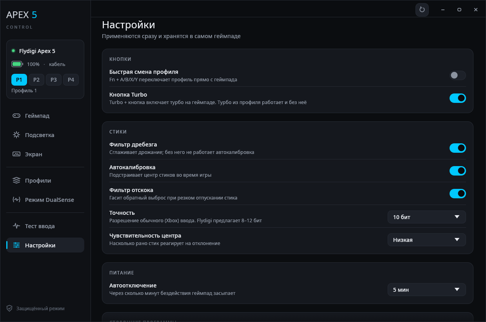

<div align="center">

# Apex 5 Control

**Нативное приложение для Linux для геймпада Flydigi Apex 5**

Подсветка, профили, макросы, стики, адаптивные курки, гироскоп и экран геймпада —
без Windows и без Flydigi Space Station.

[](https://github.com/JohnHenrySpike/apex-portal/actions/workflows/ci.yml)
[](https://github.com/JohnHenrySpike/apex-portal/releases/latest)


[English](README.md) · **Русский**



</div>

## Содержание

- [Возможности](#возможности)
- [Скриншоты](#скриншоты)
- [Установка](#установка)
- [Режим DualSense](#режим-dualsense)
- [Консольная утилита](#консольная-утилита)
- [Безопасность](#безопасность)
- [Сервер Flydigi](#сервер-flydigi)
- [Языки](#языки)
- [Как это устроено](#как-это-устроено)
- [Благодарности](#благодарности)

## Возможности

| Раздел | Что можно делать |
|---|---|
| **Геймпад** | модель, тип подключения, батарея, версии прошивок, UID, имя геймпада |
| **Подсветка** | своя для каждого профиля: 9 эффектов, до 5 цветов, яркость, скорость, вспышка при вибрации, живой предпросмотр, сохранение во флеш |
| **Профили** (4 слота) | переключение, название, переназначение кнопок, турбо, задние лепестки M1–M4 и LM/RM, копирование в другой слот, сохранение в файл и загрузка из файла (с подсветкой) |
| **Макросы** | до 5 макросов и 128 шагов, выполняются самим геймпадом |
| **Стики** | пресеты, мёртвая и внешняя зоны, смещение центра (анти-мёртвая зона) и потолок выхода, кривая по двум точкам, круг или квадрат, график кривой |
| **Курки** | рабочий ход («волосяной» курок), адаптивные режимы: гоночный, прорыв, блокировка, «очередь» (курок дрожит после точки хода), вибрация игры в курках и её пресеты Flydigi для 35 игр |
| **Вибрация рукояток** | вкл/выкл, сила, минимум и максимум каждого мотора |
| **Гироскоп** | гироскоп как стик, кнопка включения, мёртвая зона, чувствительность |
| **Экран** | своя картинка или анимация на экране геймпада, или из официальной подборки Flydigi |
| **Настройки** | быстрая смена профиля, кнопка Turbo, фильтры и автокалибровка стиков, точность, чувствительность центра, автоотключение, проверка обновлений прошивки, перехват раскладки сторонними программами (Steam), сброс всех профилей (и подсветки) к заводским |
| **Режим DualSense** | геймпад видится играм как DualSense: игры с адаптивными курками (например, No Man's Sky) сами управляют курками Apex — нагрев, отдача, вибрация; вибрация рукояток и гироскоп тоже идут через него |
| **Тест ввода** | стики, курки, все кнопки (включая M1–M4/LM/RM), гироскоп, акселерометр, частота опроса, округлость стиков, проверка моторов вибрации; режим «Для игр» — что получают игры после назначений, турбо и макросов |

## Скриншоты

<table>
  <tr>
    <td></td>
    <td></td>
  </tr>
  <tr>
    <td align="center"><b>Подсветка</b> — эффекты, цвета, живой предпросмотр</td>
    <td align="center"><b>Кнопки</b> — назначения, турбо, задние лепестки</td>
  </tr>
  <tr>
    <td></td>
    <td></td>
  </tr>
  <tr>
    <td align="center"><b>Стики</b> — кривая отклика, зоны, форма хода</td>
    <td align="center"><b>Курки</b> — рабочий ход и адаптивные режимы</td>
  </tr>
  <tr>
    <td></td>
    <td></td>
  </tr>
  <tr>
    <td align="center"><b>Режим DualSense</b> — адаптивные курки из игр</td>
    <td align="center"><b>Тест ввода</b> — всё в реальном времени</td>
  </tr>
  <tr>
    <td></td>
    <td></td>
  </tr>
  <tr>
    <td align="center"><b>Экран</b> — своя картинка или анимация</td>
    <td align="center"><b>Настройки</b> — хранятся в самом геймпаде</td>
  </tr>
</table>

## Установка

### Из релиза

Скачайте `apex5-vX.Y.Z-linux-x86_64.tar.gz` со страницы [Releases](https://github.com/JohnHenrySpike/apex-portal/releases) и выполните:

```bash
tar xzf apex5-*-linux-x86_64.tar.gz
cd apex5-*-linux-x86_64
install -Dm755 apex5 apex5ctl -t ~/.local/bin
install -Dm644 packaging/apex5-control.desktop ~/.local/share/applications/apex5-control.desktop
```

Сборки ветки `dev` лежат в артефактах её запусков на странице [Actions](https://github.com/JohnHenrySpike/apex-portal/actions/workflows/ci.yml).

### Из исходников

Нужен Rust (stable, edition 2024); системные библиотеки не нужны.

```bash
cargo build --release
install -Dm755 target/release/apex5 target/release/apex5ctl -t ~/.local/bin
install -Dm644 packaging/apex5-control.desktop ~/.local/share/applications/apex5-control.desktop
```

`tools/dist.sh ИМЯ` собирает такой же архив, как в релизе.

### Правило udev

Если приложение пишет «нет доступа», установите правило udev. Оно же нужно для загрузки картинки на экран и режима DualSense.
Приложение может поставить его само (кнопка **«Установить правило…»**, пароль спросит система) или вручную:

```bash
sudo install -Dm644 packaging/72-flydigi-apex5.rules /etc/udev/rules.d/72-flydigi-apex5.rules
```

```bash
sudo udevadm control --reload && sudo udevadm trigger
```

> [!TIP]
> Изменения сначала попадают в оперативную память геймпада (**«Применить»**). Чтобы они пережили сон и выключение,
> нажмите **«Сохранить»**: это запишет их во флеш-память геймпада.

## Режим DualSense

Приложение создаёт виртуальный DualSense (через `/dev/uhid`) и передаёт в него ввод Apex — кнопки и стики так,
как их видят игры, после назначений профиля, плюс гироскоп и акселерометр. Эффекты курков, которые игра шлёт DualSense,
переводятся в режимы Apex:

| Эффект DualSense | Режим Apex |
|---|---|
| сопротивление | **«Гоночный»**, сила растёт вместе с эффектом |
| упор | **«Прорыв»** |
| вибрация | **«Очередь»** с частотой игры |

Пока режим включён, эффекты курков из профиля не действуют. Ползунок **«Сила сопротивления от игры»** ослабляет
сопротивление (не вибрацию), если курок нужно дожимать до конца; значение хранится в `~/.config/apex5-control/dualsense.json`.

Если закрыть окно, пока режим включён, приложение остаётся в системном трее и DualSense продолжает работать.
Окно возвращает щелчок по значку или повторный запуск приложения; **«Выйти»** в меню значка выключает режим и закрывает
приложение. Второй экземпляр не запускается, а показывает окно первого.

> [!IMPORTANT]
> Steam сам открывает Apex своим драйвером и отдаёт играм его, а не DualSense. Запустите Steam кнопкой **«Запустить Steam»**
> на странице режима DualSense (уже запущенный Steam она перезапустит) или сами так:
>
> ```bash
> env SDL_GAMECONTROLLER_IGNORE_DEVICES=0x37d7/0x2501 SDL_JOYSTICK_IGNORE_DEVICES=0x37d7/0x2501 steam
> ```
>
> Steam Input у игры оставьте по умолчанию: No Man's Sky без него геймпад не видит, а эффекты курков DualSense
> получает именно через него.

Для режима нужен модуль `uhid` и доступ к `/dev/uhid`. Доступ даёт то же правило udev, а модуль загружается при старте так:

```bash
echo uhid | sudo tee /etc/modules-load.d/uhid.conf
```

## Консольная утилита

`apex5ctl` работает рядом с приложением и всегда пишет по-английски:

| Команда | Что делает |
|---|---|
| `info` | информация о геймпаде |
| `input [секунды]` | поток ввода |
| `keys [секунды]` | кнопки на выходе xpad |
| `led show\|slots\|color\|brightness\|save` | подсветка |
| `profile switch N\|backup` | переключение и резервная копия профилей |
| `screen preview\|upload` | картинка на экран |
| `ds5` | режим DualSense без окна, до Ctrl-C |
| `cloud firmware\|games\|pictures` | что есть на сервере Flydigi |

Сохранённые профили лежат в `~/.config/apex5-control/profiles/`.

## Безопасность

Каждый исходящий пакет проверяет модуль `src/safety.rs` по белому списку. **Никогда не отправляются:**

- вибрация (0x12) — только кнопкой теста: два мотора рукояток, меньше секунды, затем обязательная остановка;
- режим прошивки (31; исключение — один точный пакет для экрана, см. ниже), сброс к заводским (253), сброс всех профилей (175);
- смена режима Xbox/Switch (27), перезагрузка (29), частота опроса (20);
- заводские и тестовые команды (240–253), загрузка картинки по HID (208–211), захват геймпада сторонней программой (28);
- перезапись типа устройства (254): она меняет модель, по которой геймпад узнают и Space Station, и это приложение.

<details>
<summary>Курки, загрузка картинки и тип устройства</summary>

Эффекты курков уходят в тех же формах, что у Space Station: режимы 0–4 командой 81, «Вибрация игры» — привязкой 82
(вибрация рукояток передаётся в курок). Привязка живёт, пока геймпад подключён, даже после смены профиля,
поэтому приложение снимает её (82 с типом 0), как только в загруженном профиле курок не в режиме «Вибрация игры».
Профиль с неизвестным режимом курка не записывается.

Своя картинка на экране загружается так же, как у Flydigi: команда 31 переводит чип экрана в режим загрузки,
и кадры идут через его последовательный порт `ffaa:5555`. Команда 31 отправляется только для чипа экрана и только по кабелю
(через донгл геймпад зависает до выключения). Пишется только область картинки, адрес которой сообщил сам экран;
повторов нет. Загрузка идёт около 25 секунд на кадр, в конце геймпад перезагружается. Если она прервалась,
её можно повторить; если не выходит — выключить и включить геймпад переключателем сзади.

Тип устройства приложение только читает. Если геймпад перестал определяться как Apex 5, его тип могла переписать Space Station:
при каждом подключении она отправляет данные геймпада (UID, MAC, тип, версии прошивок) на `edge.flydigi.com`
и, если сервер ответит, что тип неверный, записывает в геймпад тип из ответа сервера и перезагружает его.

</details>

## Сервер Flydigi

Приложение обращается к серверу Flydigi (`api.flydigi.com`) только по нажатию кнопки и теми же запросами,
что Flydigi Space Station. Аккаунт не нужен, токенов нет.

- **Проверка прошивки** (Настройки → «Об устройстве» → **«Проверить»**): на сервер уходят модель и версии прошивок,
  в ответ приходят более новые версии и описание изменений от Flydigi (обычно на китайском). Прошивку приложение
  не скачивает и не ставит: обновлять её нужно во Flydigi Space Station на Windows.
- **Подборка Flydigi** (Экран): официальные картинки и анимации Apex 5. Скачиваются в
  `~/.cache/apex5-control/flydigi/screen/`, загружаются на экран так же, как свой файл.
- **Пресеты курков для игр** (Профили → Курки): для каждой игры из списка Flydigi известно, как передавать вибрацию
  рукояток в курки. Пресет ставит оба курка в режим «Вибрация игры» с этими настройками; Space Station включает их сама,
  пока игра запущена, а здесь они хранятся в профиле.

Сверку типа устройства (`edge.flydigi.com`), аналитику и вход в аккаунт приложение не повторяет.

## Языки

Язык интерфейса — английский по умолчанию, русский выбирается в **«Настройки → Приложение → Язык»**
(или на экране «Геймпад не найден»). Выбор хранится в `~/.config/apex5-control/language`;
переменная `APEX5_LANG=ru` задаёт язык на один запуск.

Переводы лежат в `locales/*.json`; как добавить свой язык — в [locales/README.md](locales/README.md).

## Как это устроено

| Путь | Что там |
|---|---|
| `src/hid.rs` | доступ к вендорскому интерфейсу hidraw (интерфейс 2, usage page 0xFFA0), формат пакетов и передача блоков данных |
| `src/safety.rs` | белый список команд |
| `src/device.rs` | информация, настройки, имя, поток ввода, сопротивление курков |
| `src/lighting.rs` | блок подсветки (380 байт: 10 кадров × 12 светодиодов) |
| `src/profile.rs` | профиль (840 байт): кнопки, стики, курки, гироскоп, макросы |
| `src/worker.rs` | фоновый поток, которому принадлежит устройство |
| `src/bridge.rs`, `src/ds5.rs`, `src/uhid.rs` | режим DualSense: виртуальный геймпад, его отчёты, перевод эффектов курков |
| `src/main.rs`, `src/ui/` | интерфейс |
| `src/lang.rs`, `locales/`, `tools/i18n.py` | языки интерфейса: английский в коде, переводы в JSON |
| `assets/apex5.svg` | рисунок геймпада для интерфейса, собирается скриптами из `tools/svg` (см. `tools/svg/README.md`) |
| `docs/spec-*.md` | спецификация протокола |

## Благодарности

Протокол взят из исследований проекта [openflydigi](https://github.com/mkaliaha/openflydigi) (MIT).
Дескриптор и отчёты признаков DualSense и раскладка его отчёта ввода тоже оттуда (`LICENSES/openflydigi-MIT.txt`).
